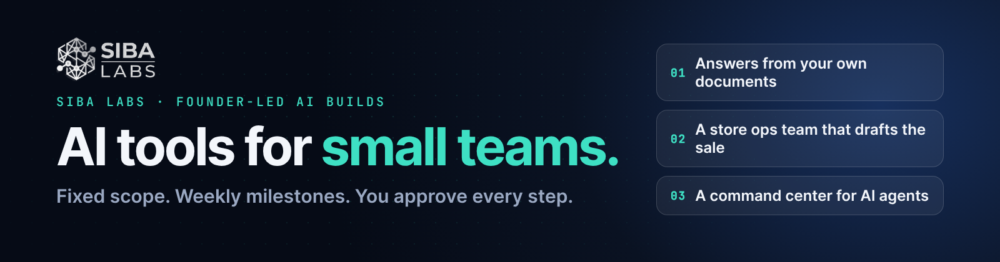
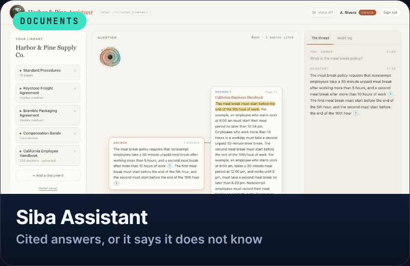
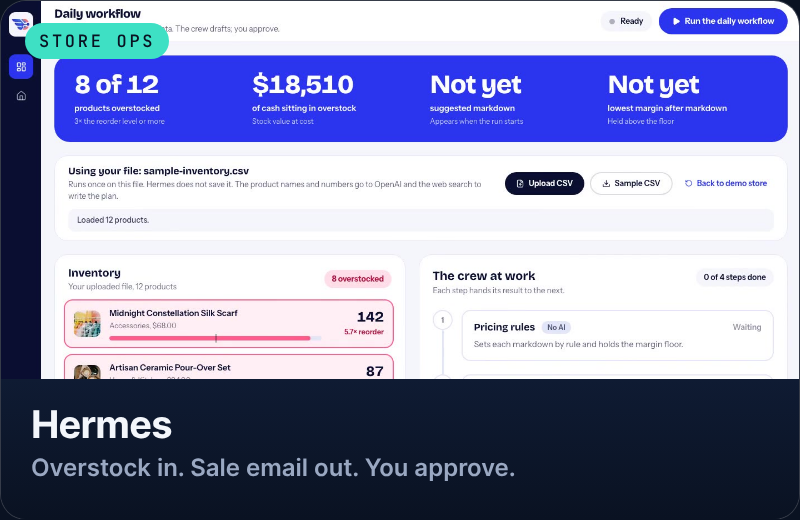
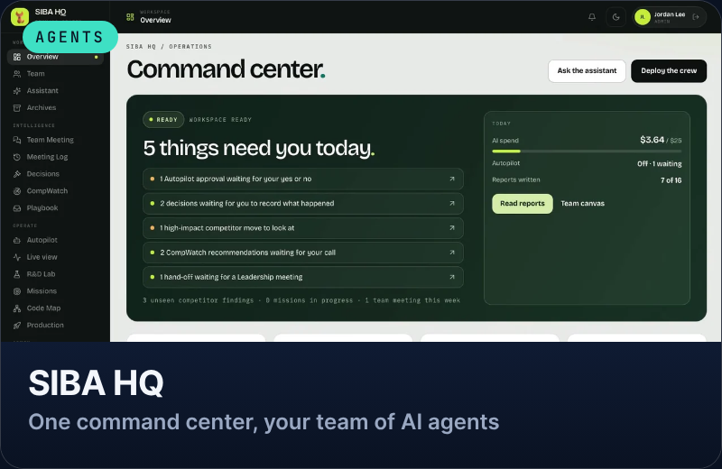

### Founder-led AI builds with a human in charge

**[See the work](SITE_URL)**

 

I build custom AI tools for small teams, from document assistants to agent teams and internal dashboards, shaped around how your business actually runs. Every build is fixed scope, delivered in weekly milestones, and nothing goes live without your approval.

## Three builds, running

<table>
<tr>
<td width="33%" valign="top">

 <b>Siba Assistant</b> 
Answers only from your own documents, quotes the passage it used, and shows each person only what their role allows. Every question is logged.
</td>
<td width="33%" valign="top">

 <b>Hermes</b> 
Finds the stock that is not moving, sets safe discounts with a margin floor, researches the market and drafts the sale email. You approve before anything goes out.
</td>
<td width="33%" valign="top">

 <b>SIBA HQ</b> 
A command center where a team of AI agents does the research and drafting, and you make the calls.
</td>
</tr>
</table>

## Code you can read

The demos above are private. These small public repos are the engineering patterns inside them, extracted so you can judge my code and documentation yourself:

| Repo | The idea |
|---|---|
| [citation-guard](https://github.com/sibalabs/citation-guard) | An AI answer is shown only if every claim quotes your own documents word for word |
| [role-scoped-data](https://github.com/sibalabs/role-scoped-data) | Roles are enforced in the database, with a tamper-evident audit log |
| [approval-gate](https://github.com/sibalabs/approval-gate) | Agents propose; nothing runs until a person approves |
| [pricing-rules](https://github.com/sibalabs/pricing-rules) | Discounts for slow stock that can never drop below your margin floor |

## What working with me looks like

1. **You message me** with the process that eats your week.
2. **A fixed-scope proposal:** a clear price, a clear timeline, three tiers.
3. **Weekly milestones:** working pieces along the way, and your approval before anything goes live.
4. **You own it:** full source code, your own accounts and keys, and fixes if something breaks.

## Stack

`Python` · `FastAPI` · `Next.js` · `Supabase (Postgres, pgvector)` · `OpenAI` · `CrewAI`

 

**Got a process that eats your week?**

